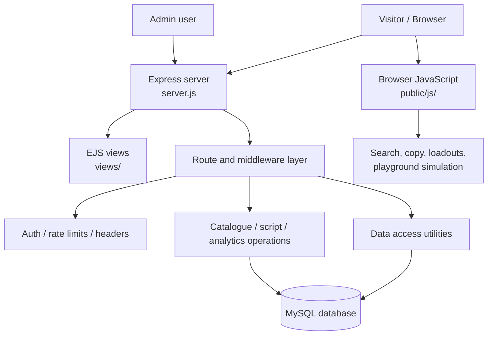

<!-- Roblox Script Nexus — project documentation -->

<p align="center">
  
</p>

<h1 align="center">Roblox Script Nexus</h1>

<p align="center">
  <strong>A dark, game-inspired web catalogue for exploring Roblox Lua/Luau code, browsing game collections, and organizing snippets.</strong>
  <br />
  Built with Node.js, Express, EJS, MySQL, and Bootstrap.
</p>

<p align="center">
  <a href="https://nodejs.org/"></a>
  <a href="https://expressjs.com/"></a>
  <a href="https://www.mysql.com/"></a>
  <a href="https://ejs.co/"></a>
  <a href="https://vercel.com/"></a>
  
</p>

<p align="center">
  <a href="#overview">Overview</a> ·
  <a href="#features">Features</a> ·
  <a href="#architecture">Architecture</a> ·
  <a href="#local-development">Local setup</a> ·
  <a href="#security-and-responsible-use">Security & responsible use</a>
</p>

---

## Overview

**Roblox Script Nexus** is an experimental full-stack web application for cataloguing Roblox Lua/Luau code snippets by game or experience. It combines a searchable catalogue, game/map detail pages, a code-copy workflow, a client-side loadout builder, a simulated playground, and an administrator area for managing catalogue entries.

The project uses server-rendered EJS pages and a MySQL database, with browser-side JavaScript for searching, language switching, UI interactions, and code organization. A Vercel deployment configuration is included, but a deploy configuration alone does not prove that the application is production-ready or currently deployed successfully.

> **Responsible use:** Some seeded examples and page labels describe game automation, aiming, ESP-style overlays, or farming. Use code only in Roblox Studio projects you own or in experiences where you have explicit permission. Do not use this project to gain an unfair advantage in public/competitive games, disrupt other players, bypass anti-cheat systems, or violate Roblox or an experience creator's rules. No script is guaranteed to be safe, undetected, or compatible.

## Project visuals

<p align="center">
  
</p>

<p align="center">
  <a href="public/videos/intro.mp4">▶ Watch the repository's introduction video</a>
  ·
  <a href="my%20intro%20video/kling_20260808_VIDEO_A_cinemati_5385_0.mp4">Open the original intro video asset</a>
</p>

The repository currently includes a logo and an introduction video, but does not include verified screenshots of every live page. Before promoting a public release, add current screenshots of the homepage, a detail page, the playground simulator, and the administration dashboard. Label mock-ups clearly so readers can distinguish artwork from functioning UI.

## Features

### Catalogue and discovery
- Dark, game-inspired interface with a responsive layout and branded visual components.
- Featured collection carousel and game/map detail pages.
- Search UI for discovering catalogue entries by game, title, or description.
- Script cards with metadata, code-copy controls, and category labels.

### Code organization
- **Loadout builder:** client-side tools for organizing selected snippets into a combined text file.
- **Lua editor interface:** CodeMirror-powered editor with a console-style demonstration UI.
- **Preview simulator:** canvas-based visual mock-ups for selected concepts.
- **Language UI:** front-end language-switching resources are included.

**Playground limitation:** `public/js/playground.js` currently extracts simple `print(...)` patterns and displays simulated output. It does not run a real Lua/Luau virtual machine, does not execute scripts inside Roblox, and should not be described as a secure execution sandbox.

### Admin and data management
- EJS-based administrator login and dashboard views.
- Server routes for managing game/map entries and associated code snippets.
- MySQL-backed catalogue data and analytics-related tables.
- Image-upload handling and a Lua input filter.

The code filter is a pattern-based input check, **not** a complete Lua sandbox, malware detector, or guarantee that code is harmless.

### Web and operations
- Node.js + Express server with EJS templates.
- MySQL access through `mysql2/promise`.
- Static files under `public/`.
- Sitemap and robots.txt routes for search-engine discovery.
- A Vercel configuration in `vercel.json`.

Feature descriptions reflect repository source inspection. Authentication, deployment, database behavior, and security controls still require independent testing before a production launch.

## Architecture



The browser playground is a **front-end simulator**, not a server-side Lua runtime. Lua code stored in the catalogue should be treated as untrusted text until separately reviewed.

## Technology stack

| Layer | Technology |
| --- | --- |
| Runtime | Node.js |
| HTTP server | Express 4 |
| Views | EJS |
| UI | HTML, CSS, Bootstrap 5, browser JavaScript |
| Database | MySQL with `mysql2/promise` |
| Authentication utilities | JWT, bcryptjs, cookies |
| Middleware | Helmet, Express Rate Limit, Express Validator |
| File handling | Multer and image processing helpers |
| Deployment configuration | Vercel (`vercel.json`) |

## Project structure

```text
.
├── server.js                 # Express entry point and application routes
├── package.json              # npm commands and dependencies
├── package-lock.json         # Locked dependency tree
├── .env.example              # Environment-variable template (review before use)
├── schema.sql                # Database schema script (contains destructive DROP TABLE statements)
├── seed.js                   # Development seed data; review before running
├── vercel.json               # Vercel routing/build configuration
├── public/
│   ├── css/style.css         # Main visual theme
│   ├── images/               # Logo and favicon
│   ├── js/                   # Search, UI, playground, loadout, and copy behavior
│   └── videos/intro.mp4      # Introduction video
├── src/
│   ├── config/db.js          # MySQL connection pool
│   ├── middleware/           # Auth, rate limiting, security headers, uploads
│   └── utils/                # Data access and Lua input filtering
└── views/
    ├── index.ejs             # Main catalogue
    ├── map.ejs               # Collection detail page
    ├── loadout.ejs           # Loadout builder
    ├── playground.ejs        # Lua editor and simulation console
    ├── profile.ejs           # User profile
    ├── privacy.ejs           # Privacy page
    ├── terms.ejs             # Terms page
    ├── admin/                # Admin login/dashboard
    └── partials/             # Shared page sections
```

## Local development

### Prerequisites

- Node.js 22.x recommended for this codebase.
- npm (included with Node.js).
- A MySQL database you control, configured with the expected schema.
- Git, if cloning the repository.

### 1. Clone and install

```bash
git clone https://github.com/computerengineer1/roblox-script-nexusv1.git
cd roblox-script-nexusv1
npm install
```

This repository is currently marked **private** on GitHub. If you do not have access, the clone command will not work until the owner grants access or changes the repository visibility.

### 2. Configure environment variables

Create a local `.env` from `.env.example`, then replace every placeholder with appropriate values. On Windows PowerShell:

```powershell
Copy-Item .env.example .env
```

Configure at least:

| Variable | Purpose |
| --- | --- |
| `PORT` | Local HTTP port (commonly `3000`) |
| `DB_HOST`, `DB_PORT` | MySQL server address and port |
| `DB_USER`, `DB_PASS`, `DB_NAME` | Database account and database name |
| `JWT_ACCESS_SECRET` | Secret for access-token signing |
| `JWT_REFRESH_SECRET` | Secret for refresh-token signing |
| `COOKIE_SECRET` | Cookie-signing secret |
| `ENCRYPTION_KEY` | Encryption-related configuration used by project utilities; verify the implementation before deployment |
| `AD_CLIENT_ID`, `AD_SLOT_ID` | Ad integration configuration, if applicable |
| `AD_GATEWAY_URL` | Optional advertising gateway URL |
| `NODE_ENV` | Set to `development` locally; use `production` only after hardening the deployment |

Use newly generated, unique secrets for each environment. Never commit your real `.env`, database credentials, JWT secrets, cookie secrets, or production tokens.

> **Deployment blocker:** The current `src/config/db.js` contains a hard-coded remote-database fallback and can use embedded connection values when database configuration is missing or matches a legacy value. Remove this fallback and rotate the exposed database credentials with the database provider **before making the repository public or deploying this source**. Configuration should fail closed if required database variables are absent.

### 3. Database setup — read before running

`schema.sql` contains `DROP TABLE IF EXISTS` statements. It is destructive to existing tables and their data. **Do not run it against a populated or production database.** Use a fresh, disposable development database or first revise the schema into non-destructive migrations and take a verified backup.

Also review `seed.js` before running it. The current seed script contains fixed administrator credentials and deletes existing administrator records before inserting its seed account. Do not run it against a live database. Replace this with a safe one-time administrator setup flow before production use.

Once the database setup and seed process have been made safe for a disposable development database, apply the reviewed schema and seed only test data. Do not copy administrator credentials from source files into documentation, tickets, or chat.

### 4. Start the application

After the database configuration has been secured and a compatible development schema is available:

```bash
npm start
```

The development script is:

```bash
npm run dev
```

Open `http://localhost:3000` in your browser. Startup success alone does not guarantee that database-backed routes, login, image handling, or every UI workflow is working; test each feature locally.

## Deployment notes

A Vercel configuration is present, and the server includes deployment-aware proxy handling. Before deploying:

1. Remove hard-coded database credentials and rotate any credentials that have been present in source control.
2. Set environment variables through the hosting provider's environment-variable settings; do not commit them.
3. Configure a managed MySQL-compatible database with TLS and least-privilege access.
4. Replace destructive schema setup with migrations and a safe, idempotent seed process.
5. Verify authentication, session cookies, CSRF protection, uploads, rate limiting, and error handling in the actual deployment environment.
6. Audit external advertising scripts and tracking behavior; confirm that the privacy/terms pages accurately describe what the deployed site collects.
7. Run a dependency and security audit, and test the deployment using a staging database before exposing it publicly.

Do not assume that the presence of `vercel.json` means deployment succeeds. The source uses a relational database and must be configured for a supported, persistent database service.

## Security and responsible use

This project handles user-submitted code and server-side credentials. Important caveats found during source review:

- **Database secrets:** the database module includes embedded fallback connection values. Treat them as exposed; remove them from code and rotate them before public release.
- **Administrator seed:** `seed.js` embeds fixed login credentials and deletes prior admin entries. Replace it with an explicit, secure, one-time bootstrap process.
- **Authentication verification:** audit the Google sign-in callback so ID tokens are cryptographically verified for signature, issuer, audience, and expiry using Google's supported server-side library. Decoding a token payload alone is not authentication.
- **Lua filtering is not sandboxing:** `sanitizeLua.js` uses a list of patterns. Blacklists can miss dangerous or obfuscated behavior and can reject harmless code. Never run untrusted Lua/Luau on a host with sensitive data.
- **Playground behavior:** the current console simulates a limited set of `print` output; it is not an isolated code execution environment.
- **Third-party scripts and ads:** review external scripts and ad providers for privacy, content, and supply-chain risks before production deployment.
- **Uploads and data:** validate content and size server-side, limit access, and document how uploaded images, account information, IP addresses, and analytics events are stored.
- **Fair play and authorization:** examples that automate gameplay, aim at other players, or reveal hidden state must not be used to cheat or bypass protections in public experiences. Prefer scripts and tools for Roblox Studio, private test environments, and experiences you are authorized to modify.

## Current limitations / recommended roadmap

- [ ] Remove and rotate embedded database credentials; fail startup when required environment settings are absent.
- [ ] Replace the fixed admin seed with a safe, one-time bootstrap flow.
- [ ] Verify Google ID tokens properly on the server.
- [ ] Replace the Lua blacklist with a clearly scoped validation approach; never call it a secure sandbox.
- [ ] Rename and label the playground as a simulation until real, isolated Lua/Luau execution is implemented and independently reviewed.
- [ ] Add automated tests for database operations, authorization checks, search, and critical routes.
- [ ] Add migrations and sample seed data that cannot overwrite real administrator records.
- [ ] Add real screenshots and an accessible demo after checking the published UI.
- [ ] Audit third-party scripts, dependency versions, privacy disclosures, and production error handling.
- [ ] Add a root-level `LICENSE` file and verify the licensing of all third-party assets and dependencies.

## Contributing

Contributions to documentation, accessibility, localization, performance, tests, security, and legitimate Roblox Studio development workflows are welcome.

1. Open an issue with a clear description of the proposed change.
2. Create a focused branch.
3. Include reproduction steps or tests for bug fixes where practical.
4. Open a pull request summarizing the change and any limitations.

Do not contribute code intended to exploit public experiences, evade anti-cheat systems, steal accounts or data, or harm other players.

## License

The current `package.json` declares `ISC`, but a root-level `LICENSE` file was not present during this review. Add the appropriate license file and confirm that all included scripts, media, and third-party dependencies may be redistributed under the intended terms. Until then, do not assume repository visibility alone grants permission to reuse the contents.

## Disclaimer

Roblox Script Nexus is an independent project and is not affiliated with, endorsed by, or sponsored by Roblox Corporation. Roblox and related names are used only to describe the software's intended ecosystem.

---

## ملخص عربي

**Roblox Script Nexus** هو مشروع ويب مبني باستخدام Node.js وExpress وEJS وMySQL لعرض وتنظيم أمثلة Lua/Luau حسب اللعبة أو التجربة، مع البحث وصفحات التفاصيل وباني مجموعات الأكواد ولوحة إدارة وواجهة محاكاة.

انتبه إلى أن صفحة الـ Playground الحالية لا تشغّل Lua فعليًا؛ إنها تعرض مخرجات محاكاة بسيطة. كذلك توجد بيانات اتصال قاعدة بيانات مضمّنة في الكود، ويحتوي سكربت التهيئة على بيانات مسؤول ثابتة وقد يحذف سجلات المسؤولين الحالية. يجب معالجة هذه النقاط وتدوير بيانات الدخول قبل جعل المستودع عامًا أو نشر التطبيق.

استخدم الأكواد فقط في Roblox Studio أو في تجارب لديك صلاحية صريحة لتعديلها، ولا تستخدمها للغش أو تجاوز أنظمة الحماية في الألعاب العامة.
